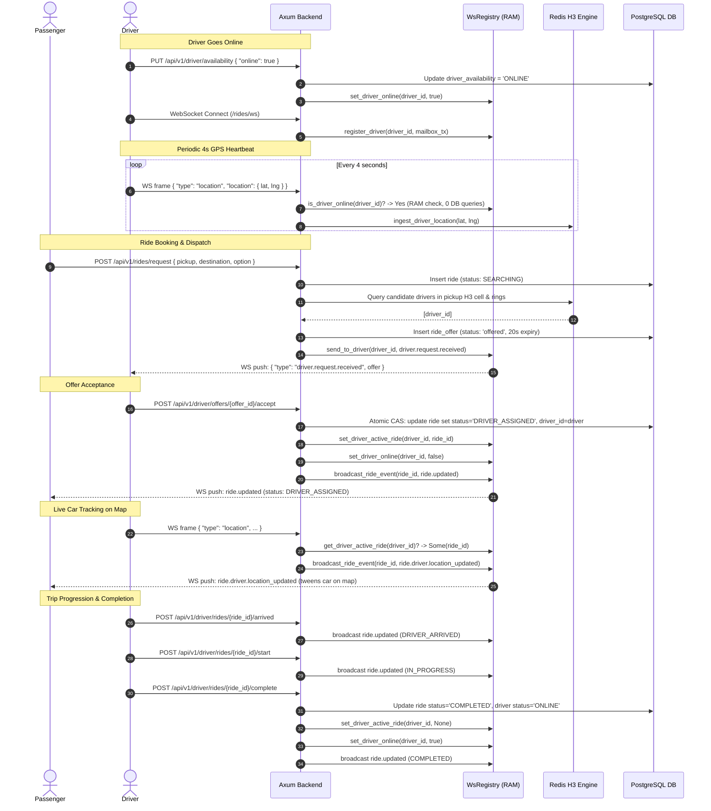

# K-Ride VRP & Realtime WebSocket Specification

This document provides a comprehensive, unambiguous reference for human engineers and AI assistants interacting with or maintaining the **K-Ride Vehicle Routing Problem (VRP) & Realtime Dispatching Engine**.

---

## 1. System Architecture & Protocols

```
┌────────────────────────────────────────────────────────────────────────┐
│                              Clients                                   │
│            Driver App (Mobile)        Passenger App (Mobile/Web)       │
└─────────────────────┬───────────────────────────────┬──────────────────┘
                      │                               │
         WebSocket    │                               │   HTTP / JSON
         /rides/ws    │                               │   /api/v1/rides/*
                      ▼                               ▼
┌────────────────────────────────────────────────────────────────────────┐
│                         Axum Backend Server                            │
│  ┌───────────────────────────────┐   ┌───────────────────────────────┐ │
│  │      WsRegistry (In-Memory)   │   │     HTTP Handlers & Auth      │ │
│  │ - Driver Mailboxes (MPSC)     │   │ - Passenger: /api/v1/rides    │ │
│  │ - Ride Broadcast Channels     │   │ - Driver:    /api/v1/driver   │ │
│  │ - Online State & Active Rides │   │ - Fleet:     /api/v1/cars     │ │
│  │ - Stale Connection Cleaner    │   │ - JWT Authentication Claims   │ │
│  └───────────────┬───────────────┘   └───────────────┬───────────────┘ │
└──────────────────┼───────────────────────────────────┼─────────────────┘
                   │                                   │
                   ▼                                   ▼
┌──────────────────────────────────────┐  ┌──────────────────────────────┐
│        Redis (In-Memory Hot Path)    │  │ PostgreSQL (Cold/State Truth)│
│ - H3 Geospatial Spatial Indexing     │  │ - Persistent Ride State Machine│
│ - Driver Cell Tracking & Active Pins │  │ - Driver & User Profiles     │
│ - 15-second Dead-Man Expiry (TTL)    │  │ - Vehicle Registrations      │
└──────────────────────────────────────┘  └──────────────────────────────┘
```

### 1.1 Base URLs & Route Mounting
* **Base HTTP API**: `http://localhost:9990/api/v1`
* **Realtime WebSocket**: `ws://localhost:9990/rides/ws` (or `ws://localhost:9990/api/v1/rides/ws`)
* **Swagger OpenAPI Docs**: `http://localhost:9990/swagger-ui`

### 1.2 Authentication
All protected REST endpoints and the WebSocket connection require authentication via either:
1. **HTTP Authorization Header**: `Authorization: Bearer <JWT_ACCESS_TOKEN>`
2. **HTTP Cookie**: Session cookie containing the JWT token.

The JWT payload decodes into `Claims`:
* `user_id`: UUID of the authenticated account.
* `role`: User role (`"Driver"`, `"Regular"`, or `"Admin"`).

---

## 2. Realtime WebSocket Protocol (`/rides/ws`)

### 2.1 Connection Handshake
* **Endpoint**: `GET /rides/ws`
* **Headers**:
  ```http
  Upgrade: websocket
  Connection: Upgrade
  Authorization: Bearer <JWT_TOKEN>
  ```
* On connection upgrade:
  * If the caller is a `Driver`, the server creates an in-memory mailbox `mpsc::channel(64)` and registers the driver in `WsRegistry`.
  * The connection is split into an **Outgoing Speaker** task and an **Incoming Listener** task.
  * **Zero Database Queries**: The connection handshake does **not** query PostgreSQL or modify driver availability. Availability is decoupled and strictly controlled via HTTP `PUT /api/v1/driver/availability`.

### 2.2 Connection Health & Stale Connection Cleaner
To prevent leaked connections caused by abrupt client closures (e.g., killed browser, airplane mode, subway tunnels):
1. **Server Keepalive Ping (Every 20 seconds)**:
   The server transmits a WebSocket protocol-level `Ping` frame down each open connection every 20s. If the client socket is broken, the write fails immediately (`broken pipe`), tearing down the connection task.
2. **Inactivity Watchdog Timeout (45 seconds)**:
   The incoming message reader has a `tokio::time::timeout` of 45 seconds. If no message or heartbeat is received within 45s, the socket is cleanly terminated and unregistered.
3. **Background Sweeper Worker (Runs every 15s)**:
   A standing background worker scans `WsRegistry`. It evicts drivers with closed channels or whose last activity was $> 60$ seconds ago. It also prunes empty `ride_channels` with zero active subscribers.

---

### 2.3 Client $\to$ Server Frames (`IncomingWsFrame`)

Clients send JSON-formatted text messages with a `"type"` discriminator:

#### 1. GPS Location Heartbeat (`type: "location"`)
Sent by drivers every **2 to 4 seconds**.
```json
{
  "type": "location",
  "location": {
    "point": {
      "lat": 6.524379,
      "lng": 3.379206
    },
    "heading": 182.5,
    "speedMps": 11.2,
    "accuracyMeters": 4.5,
    "recordedAt": "2026-10-15T12:00:00.000Z"
  }
}
```
* **Performance Hot Path**: Ingests directly into Redis H3 spatial index (`dispatcher.ingest_driver_location`) **only if driver is online in RAM**.
* **Zero DB queries**: If the driver is on an active trip, the server reads `active_ride_id` directly from in-memory RAM and broadcasts `ride.driver.location_updated` to the passenger channel.

#### 2. Channel Subscription (`type: "subscribe"`)
Subscribes the connection to broadcast updates for a specific ride:
```json
{
  "type": "subscribe",
  "channel": "ride:9b1deb4d-3b7d-4bad-9bdd-2b0d7b3dcb6d"
}
```

#### 3. Channel Unsubscription (`type: "unsubscribe"`)
Unsubscribes from updates for a ride:
```json
{
  "type": "unsubscribe",
  "channel": "ride:9b1deb4d-3b7d-4bad-9bdd-2b0d7b3dcb6d"
}
```

#### 4. Heartbeat Ping (`type: "ping"`)
Application-level ping frame:
```json
{
  "type": "ping"
}
```
* **Server Response**: `{ "type": "pong" }`

---

### 2.4 Server $\to$ Client Messages (`OutgoingWsMessage`)

The server pushes two types of messages:
1. **Pong frame**: `{ "type": "pong" }`
2. **Event frame**: `{ "type": "event", "event": <WsEventFrame> }`

#### The Standard Event Frame Envelope (`WsEventFrame`)
```json
{
  "type": "event",
  "event": {
    "id": "evt_01927e1b-4f92-7b2c-80a1-d9a8f2c3d4e5",
    "rideId": "9b1deb4d-3b7d-4bad-9bdd-2b0d7b3dcb6d",
    "seq": 1,
    "rideVersion": 3,
    "occurredAt": "2026-10-15T12:00:02.123Z",
    "payload": { ... }
  }
}
```

#### Server Event Types Reference

| Event (`payload.type`) | Target Recipient | Trigger / When | Description / Client Action |
|:---|:---|:---|:---|
| `driver.request.received` | Server $\to$ Candidate Driver | Match engine finds driver | Carries `offer: RideOfferView`. Shows driver offer sheet with 20s countdown. |
| `driver.request.expired` | Server $\to$ Driver | 20s offer countdown ends | Notifies driver the offer expired. Dismisses offer sheet. |
| `driver.request.withdrawn` | Server $\to$ Driver | Rider cancelled / another driver accepted | Carries `offerId` and `reason: "taken" \| "cancelled"`. |
| `driver.availability.changed` | Server $\to$ Driver | Availability toggled via REST | Notifies driver app of online/offline status confirmation. |
| `ride.updated` | Server $\to$ Rider & Driver | Any state machine transition | Carries full `ride: RideProjection`. Drives UI phase changes. |
| `ride.driver.location_updated` | Server $\to$ Rider | Driver sends 4s GPS fix | Carries `location: LiveLocation`. Smoothly tweens car on passenger map. |

---

### 2.5 Server Event Payload Schemas

#### Event: `driver.request.received`
```json
{
  "type": "event",
  "event": {
    "id": "evt_01927e1b-4f92-7b2c-80a1-d9a8f2c3d4e5",
    "rideId": "9b1deb4d-3b7d-4bad-9bdd-2b0d7b3dcb6d",
    "seq": 1,
    "rideVersion": 1,
    "occurredAt": "2026-10-15T12:00:00Z",
    "payload": {
      "type": "driver.request.received",
      "offer": {
        "offerId": "f47ac10b-58cc-4372-a567-0e02b2c3d479",
        "rideId": "9b1deb4d-3b7d-4bad-9bdd-2b0d7b3dcb6d",
        "expiresAt": "2026-10-15T12:00:20Z",
        "pickup": {
          "name": "Koinonia Global Headquarters",
          "point": { "lat": 6.5244, "lng": 3.3792 }
        },
        "destination": {
          "name": "Murtala Muhammed Airport Terminal 2",
          "point": { "lat": 6.5774, "lng": 3.3212 }
        },
        "option": {
          "id": "standard",
          "name": "Standard",
          "vehicleClass": "sedan",
          "capacity": 4,
          "shared": false
        },
        "fare": { "amountMinor": 350000, "currency": "NGN" },
        "driverEarning": { "amountMinor": 350000, "currency": "NGN" },
        "tripDistanceMeters": 14200,
        "tripDurationSeconds": 1800,
        "pickupDistanceMeters": 850,
        "pickupEtaSeconds": 240,
        "passenger": {
          "id": "a1b2c3d4-0000-0000-0000-000000000001",
          "firstName": "Grace",
          "lastName": "Adeyemi",
          "phone": "+2348012345678",
          "rating": 4.92
        }
      }
    }
  }
}
```

#### Event: `ride.driver.location_updated`
```json
{
  "type": "event",
  "event": {
    "id": "evt_01927e1b-9999-7b2c-80a1-d9a8f2c3d4e5",
    "rideId": "9b1deb4d-3b7d-4bad-9bdd-2b0d7b3dcb6d",
    "seq": 1,
    "occurredAt": "2026-10-15T12:01:04Z",
    "payload": {
      "type": "ride.driver.location_updated",
      "location": {
        "point": { "lat": 6.5255, "lng": 3.3781 },
        "heading": 175.0,
        "speedMps": 12.5,
        "accuracyMeters": 3.0,
        "recordedAt": "2026-10-15T12:01:04Z"
      }
    }
  }
}
```

---

## 3. Passenger REST API Endpoints (`/api/v1/rides`)

All endpoints require JWT authorization header or session cookie.

### 3.1 Get Passenger Viewer Context
* **Endpoint**: `GET /api/v1/rides/me`
* **Response `200 OK`**:
  ```json
  {
    "user": {
      "id": "a1b2c3d4-...",
      "firstName": "Grace",
      "lastName": "Adeyemi",
      "phone": "+2348012345678",
      "rating": 4.95
    },
    "activeRide": null
  }
  ```

### 3.2 Fare & Route Estimate
* **Endpoint**: `POST /api/v1/rides/estimate`
* **Request Body**:
  ```json
  {
    "pickup": {
      "name": "Koinonia Headquarters",
      "point": { "lat": 6.5244, "lng": 3.3792 }
    },
    "destination": {
      "name": "Ikeja City Mall",
      "point": { "lat": 6.6194, "lng": 3.3581 }
    }
  }
  ```
* **Response `200 OK`**:
  ```json
  {
    "pickup": { "name": "Koinonia Headquarters", "point": { "lat": 6.5244, "lng": 3.3792 } },
    "destination": { "name": "Ikeja City Mall", "point": { "lat": 6.6194, "lng": 3.3581 } },
    "route": {
      "points": [{ "lat": 6.5244, "lng": 3.3792 }, { "lat": 6.6194, "lng": 3.3581 }],
      "distanceMeters": 18200,
      "durationSeconds": 2400,
      "source": "road"
    },
    "options": [
      {
        "option": {
          "id": "standard",
          "name": "Standard",
          "vehicleClass": "sedan",
          "capacity": 4,
          "shared": false
        },
        "fare": { "amountMinor": 420000, "currency": "NGN" },
        "etaSeconds": 300,
        "surgeMultiplier": 1.0
      }
    ],
    "expiresAt": "2026-10-15T12:15:00Z"
  }
  ```

### 3.3 Request a Ride
* **Endpoint**: `POST /api/v1/rides/request`
* **Request Body**:
  ```json
  {
    "optionId": "standard",
    "pickup": { "name": "Koinonia HQ", "point": { "lat": 6.5244, "lng": 3.3792 } },
    "destination": { "name": "Ikeja City Mall", "point": { "lat": 6.6194, "lng": 3.3581 } },
    "paymentMethod": "cash",
    "passengersCount": 1
  }
  ```
* **Response `201 Created`**: Returns `RideProjection` with status `SEARCHING`. Background matching engine immediately dispatches to closest online drivers.

### 3.4 Get Current Active Ride
* **Endpoint**: `GET /api/v1/rides/current`
* **Response `200 OK`**: Returns `RideEnvelope` containing `{ "ride": RideProjection | null }`.

### 3.5 Cancel Ride (Passenger)
* **Endpoint**: `POST /api/v1/rides/{ride_id}/cancel`
* **Request Body**: `{ "reason": "Changed my mind" }`
* **Response `200 OK`**: Returns updated `RideProjection`. If a driver was assigned, driver is immediately returned to `ONLINE` in RAM and database.

### 3.6 Safety & Emergency SOS
* **Report SOS**: `POST /api/v1/rides/{ride_id}/sos`
  * Body: `{ "triggerLocation": { "point": { "lat": ..., "lng": ... }, "recordedAt": "..." } }`
* **Submit Safety Report**: `POST /api/v1/rides/{ride_id}/safety-reports`
* **Generate Live Sharing Link**: `POST /api/v1/rides/{ride_id}/share-link`

---

## 4. Driver REST API Endpoints (`/api/v1/driver`)

### 4.1 Get & Set Availability
* **Get Availability**: `GET /api/v1/driver/availability`
* **Update Availability**: `PUT /api/v1/driver/availability`
  * **Request Body**:
    ```json
    {
      "online": true
    }
    ```
  * **Behavior**:
    * Updates database `driver_availability` record.
    * Updates in-memory registry: `ws_registry.set_driver_online(claims.user_id, true)`.
    * If `online == false`, immediately removes driver from Redis spatial index (`dispatcher.remove_driver`).
    * Emits `driver.availability.changed` event down WebSocket.

### 4.2 Ride Offers (Accept / Decline)
* **Accept Offer**: `POST /api/v1/driver/offers/{offer_id}/accept`
  * **Concurrency Protection**: Compare-and-swap on `rides.status = SEARCHING AND driver_id IS NULL`. First driver wins (`200 OK`); subsequent drivers receive `409 Conflict`.
  * **State Changes**:
    * Driver marked `ON_TRIP` in database.
    * In-memory registry sets `ws_registry.set_driver_active_ride(driver_id, Some(ride_id))`.
    * In-memory registry sets `ws_registry.set_driver_online(driver_id, false)` (removed from dispatch matching pool while on trip).
    * Broadcasts `ride.updated` (`status: DRIVER_ASSIGNED`) to passenger.
* **Decline Offer**: `POST /api/v1/driver/offers/{offer_id}/decline`

### 4.3 Trip Lifecycle Progression
* **Driver Arrived at Pickup**: `POST /api/v1/driver/rides/{ride_id}/arrived`
  * Transitions status to `DRIVER_ARRIVED`.
* **Start Trip**: `POST /api/v1/driver/rides/{ride_id}/start`
  * Transitions status to `IN_PROGRESS`.
* **Complete Trip**: `POST /api/v1/driver/rides/{ride_id}/complete`
  * Transitions status to `COMPLETED`.
  * Restores driver availability to `ONLINE` in database and `ws_registry`.
  * Clears `active_ride` in `ws_registry`.
* **Cancel Trip (Driver)**: `POST /api/v1/driver/rides/{ride_id}/cancel`
  * Allowed only before trip starts. Resets ride to `SEARCHING` for re-dispatch. Restores driver to `ONLINE`.

### 4.4 HTTP Fallback Location Fix
* **Endpoint**: `POST /api/v1/driver/location`
* **Usage**: Fallback if WebSocket is disconnected. Ingests GPS into PostgreSQL and Redis H3.

---

## 5. Fleet & Cars API Endpoints (`/api/v1/cars`)

Admin/management endpoints for vehicle registration and vehicle-to-driver assignments.

* `POST /api/v1/cars` — Register new car (Admin only)
* `GET /api/v1/cars` — List all registered cars (with filters: `status`, `make`, `model`, `plate_number`)
* `GET /api/v1/cars/{car_id}` — Get single car details
* `PATCH /api/v1/cars/{car_id}` — Update car details/status (Admin only)
* `DELETE /api/v1/cars/{car_id}` — Delete car record (Admin only)
* `POST /api/v1/cars/{car_id}/assign-user` — Assign car to a designated driver account

---

## 6. End-to-End Dispatch Sequence Diagram



---

## 7. Status Machine Reference (`RideStatus`)

| Ride Status | Terminal? | Can Transition To |
|:---|:---:|:---|
| `SEARCHING` | No | `DRIVER_ASSIGNED`, `NO_DRIVERS`, `CANCELLED` |
| `NO_DRIVERS` | Yes | Terminal (can retry via `/retry`) |
| `DRIVER_ASSIGNED` | No | `DRIVER_ARRIVED`, `CANCELLED` |
| `DRIVER_ARRIVED` | No | `IN_PROGRESS`, `CANCELLED` |
| `IN_PROGRESS` | No | `COMPLETED` (cannot cancel once started) |
| `COMPLETED` | Yes | Terminal |
| `CANCELLED` | Yes | Terminal |
